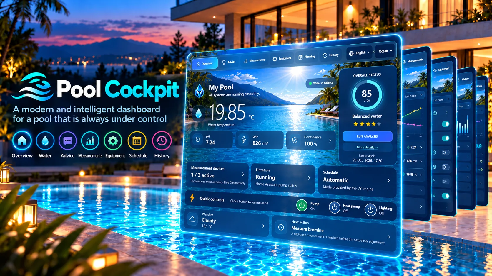
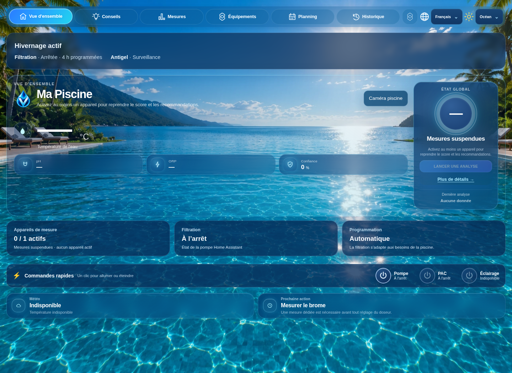
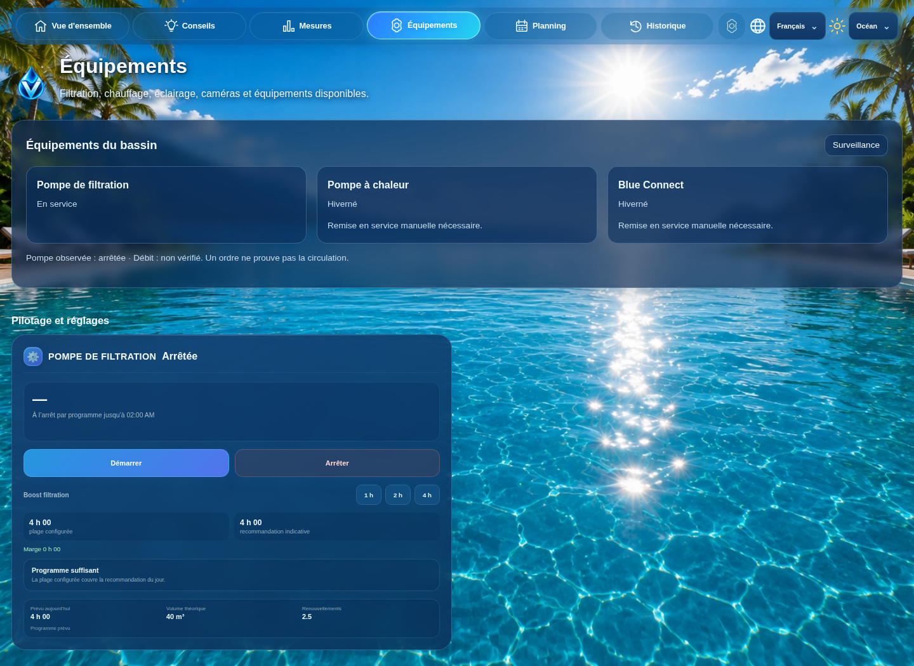
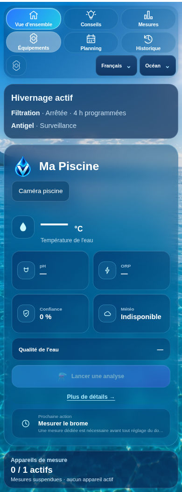

<div align="center">

# 🌊 Pool Cockpit

### Votre piscine, enfin simple à comprendre. Directement dans Home Assistant.

**Qualité de l'eau · Filtration · Pompe à chaleur · Météo · Planning · Hivernage actif**

[**🇬🇧 English**](README.md) · [**Français**](README.fr.md)

  



<sub>La planche graphique originale de Pool Cockpit, conservée pour l'identité visuelle du projet. Les vraies captures d'écran de la V4.3.0 figurent plus bas, dans la galerie.</sub>

**[Démarrer facilement](#installer-en-trois-étapes)** · **[Découvrir l'hivernage](#lhivernage-expliqué-simplement)** · **[Voir les écrans](#découvrez-linterface)** · **[English](README.md)**

</div>

---

## Une piscine connectée, sans multiplier les applications

Température de l'eau dans une application, filtration dans une autre, pompe à chaleur ailleurs… **Pool Cockpit rassemble dans un seul tableau de bord les informations déjà disponibles dans Home Assistant**.

Vous retrouvez les mesures de l'eau, des conseils de filtration, l'état de vos équipements et vos programmations. Tout est conçu pour être lisible, que vous soyez sur un ordinateur, une tablette ou un téléphone.

> **Vous découvrez Home Assistant ?** C'est le logiciel qui réunit vos appareils connectés. Pool Cockpit ajoute une interface claire pour suivre votre piscine. Les équipements doivent déjà être reliés à Home Assistant par les intégrations adaptées.

### En pratique, qu'est-ce que je peux faire ?

| Rubrique | À quoi ça sert ? |
| --- | --- |
| 🏠 **Vue d'ensemble** | Savoir rapidement comment va ma piscine |
| 💡 **Conseils** | Comprendre ce qui mérite mon attention |
| 🧪 **Mesures** | Consulter la température, le pH ou le Redox (ORP) disponibles |
| ⚙️ **Équipements** | Suivre la pompe, la PAC, les sondes et leur état |
| 📅 **Planning** | Comprendre les horaires de filtration, les conseils et la durée appliquée |
| 🕘 **Historique** | Retrouver les événements et les évolutions de mesure |

Les informations disponibles dépendent des appareils et des entités configurés chez vous.

## ✨ Les nouveautés de la V4.3.0

### Un vrai mode hivernage, sans perdre vos habitudes

L'hiver arrive ? Vous souhaitez réduire la filtration et ranger certains équipements sans perdre votre programmation habituelle ? La V4.3.0 ajoute trois modes clairement identifiés :

- **Normal** : votre fonctionnement habituel.
- **Hivernage actif** : vous confirmez un programme de filtration adapté à l'hiver et le statut de chaque équipement.
- **Maintenance** : vous signalez une intervention sur le circuit, afin d'éviter des commandes incompatibles avec sa sécurité.

**Exemple :** vous pouvez choisir une filtration de **4 h de 2 h à 6 h**. Cette durée n'est qu'une proposition : elle n'assure pas à elle seule une protection contre le gel. Votre ancienne programmation est conservée pour le retour en mode Normal.

### Une protection antigel qui vous dit ce qu'elle sait… et ce qu'elle ne sait pas

Avec **une sonde de température locale correctement configurée**, Pool Cockpit peut demander la mise en marche de la filtration lorsqu'il fait froid, même en dehors des horaires prévus.

Ses seuils initiaux proposés sont de **3 °C pour demander la marche** et **5 °C pour quitter l'alerte**, avec des temporisations pour éviter les démarrages et arrêts incessants.

Mais le plus important, c'est la transparence : l'écran distingue **la demande de marche**, **l'état de la pompe observé par Home Assistant** et **la preuve du débit d'eau**, cette dernière nécessitant un capteur de débit réel. En cas de capteur absent ou de panne, il vous avertit.

Les sécurités hydrauliques restent prioritaires. La commande antigel ne doit jamais contourner un verrou de marche à sec ou une interdiction de circulation.

**⚠️ À savoir :** Pool Cockpit est une aide logicielle, **pas un coffret hors gel certifié et autonome**. Si Home Assistant, l'électricité, la pompe ou la circulation d'eau sont indisponibles, le logiciel ne peut pas empêcher le gel. **L'antigel est désactivé par défaut** après migration et doit être activé seulement après validation de votre installation. Une protection matérielle indépendante ou un hivernage passif peut être nécessaire, particulièrement lors d'absences prolongées.

### Chaque équipement conserve son propre statut

Pompe à chaleur, Blue Connect, Flipr… Vous pouvez signaler séparément qu'un équipement est **hiverné**, puis le remettre en service manuellement quand la saison reprend.

Une sonde hivernée n'alimente plus les mesures courantes ; lorsqu'elle est réactivée, Pool Cockpit attend une **nouvelle mesure** avant de lui faire confiance. Les commandes de PAC restent **désactivées par défaut**.

## Découvrez l'interface

Ces images sont de **vraies captures du tableau de bord V4.3.0**, obtenues sur une installation Home Assistant de recette avec des appareils simulés.

| Vue d'ensemble — l'essentiel en un coup d'œil | Planning — comprendre les horaires et la filtration |
| :---: | :---: |
|  |  |

| Équipements — des états indépendants | Mobile — la même interface, plus compacte |
| :---: | :---: |
|  |  |

Le **thème Océan** est présenté ici ; d'autres thèmes et langues sont disponibles. Retrouvez d'autres captures et les choix d'ergonomie dans le [bilan UX V4.3.0](release/v4.3.0/UX_REVIEW.md).

## 🏊 Votre piscine ou 🎮 une démonstration ?

| | Mode Réel | Mode Démonstration |
| --- | --- | --- |
| **Faut-il une piscine équipée ?** | Oui, pour les vraies mesures | Non |
| **Faut-il Home Assistant ?** | Oui | Oui |
| **D'où viennent les données ?** | De vos équipements déclarés dans Home Assistant | De valeurs fictives |
| **La démo peut-elle agir sur une vraie pompe ?** | Sans objet | **Jamais** |

**Mode Réel :** Pool Cockpit utilise les données de vos intégrations Home Assistant. Par exemple, les projets indépendants [Blue Connect Local](https://github.com/Adrien40/ha-blue-connect-local) et [Flipr Local](https://github.com/Adrien40/ha-flipr-local) peuvent fournir les informations de ces sondes. **Ils ne sont pas inclus dans Pool Cockpit** et ne sont utiles que si vous disposez de ces appareils.

**Mode Démonstration :** explorez les écrans et les données fictives, sans matériel de piscine. Ce mode ne simule pas une protection antigel réelle.

## Installer en trois étapes

La V4.3.0 prend en charge les installations **Home Assistant Core / Docker** disposant d'un accès au dossier contenant le fichier `configuration.yaml`. Il faut Python 3, Git et une **sauvegarde complète de Home Assistant**. L'installation ne passe **pas par HACS**.

**1. Récupérer Pool Cockpit**

```bash
git clone https://github.com/vinzgithub/ha-pool-cockpit.git
cd ha-pool-cockpit
```

**2. Vérifier avant de modifier quoi que ce soit**

```bash
sh install.sh --config /chemin/vers/homeassistant/config --dry-run
```

**3. Sauvegarder Home Assistant, l'arrêter, puis installer**

```bash
sh install.sh --config /chemin/vers/homeassistant/config --yes
```

**Redémarrez ensuite Home Assistant manuellement**, puis actualisez le navigateur. Le tableau de bord **Piscine / Pool Cockpit** apparaît dans Home Assistant.

L'installateur reconnaît une **installation neuve** ou une **V4.2.1 officielle**. Il sauvegarde les fichiers et les paramètres avant une mise à jour. S'il ne reconnaît pas votre installation, il **refuse d'écraser les fichiers**. Il ne redémarre ni n'arrête automatiquement Home Assistant.

**Vous utilisez une autre version ou Home Assistant OS ?** Lisez d'abord le [guide d'installation et de restauration](docs/user/INSTALLATION.md). Ne forcez pas une mise à jour non reconnue.

## L'hivernage expliqué simplement

**Un jour doux de novembre :** vous validez une programmation réduite, puis signalez que la PAC et les sondes ont été hivernées. La programmation normale est conservée.

**Une nuit froide :** si la sonde locale relève une température suffisamment basse, Pool Cockpit peut demander une filtration supplémentaire en dehors du planning, **à condition que les sécurités hydrauliques l'autorisent**. L'interface distingue ce qui est demandé de ce qui fonctionne réellement.

**Un problème survient :** mesure trop ancienne, pompe non confirmée, absence de débit… Le tableau de bord vous alerte et ne prétend pas que le bassin est protégé.

Les réglages précis, délais, sécurités et limites sont détaillés dans le [guide complet d'hivernage V4.3.0](release/v4.3.0/README.md).

## Questions fréquentes

<details>
<summary><strong>Pool Cockpit va-t-il effacer ma configuration Home Assistant ?</strong></summary>

Non, une mise à jour reconnue depuis la V4.2.1 conserve le tableau de bord et les paramètres existants. Une sauvegarde datée est créée auparavant. Comme la V4.3.0 modifie le backend Python et le stockage, suivez la procédure d'arrêt et de redémarrage documentée.

</details>

<details>
<summary><strong>Faut-il absolument acheter une sonde Blue Connect ou Flipr ?</strong></summary>

Non. Ces appareils sont facultatifs. Pool Cockpit peut utiliser les entités d'autres intégrations compatibles, et le mode Démonstration fonctionne sans matériel de piscine.

</details>

<details>
<summary><strong>Le mode hivernage garantit-il que ma piscine ne gèlera pas ?</strong></summary>

Non. Une filtration quotidienne réduite ne garantit pas le hors gel. La protection antigel logicielle dépend aussi du capteur local, de Home Assistant, de l'électricité, de la pompe et de la circulation. Il faut respecter les recommandations du fabricant et prévoir une protection adaptée à l'installation.

</details>

<details>
<summary><strong>Et si je veux revenir à la version précédente ?</strong></summary>

Arrêtez Home Assistant. L'installateur indique le chemin de la sauvegarde et propose une option `--rollback`. Il faut **restaurer ensemble** le JavaScript, le backend Python et les données antérieures à la migration. Consultez la [procédure de retour arrière](docs/user/INSTALLATION.md).

</details>

## Pour aller plus loin

**[Les releases GitHub](https://github.com/vinzgithub/ha-pool-cockpit/releases)** · **[Le guide hivernage V4.3.0](release/v4.3.0/README.md)** · **[Installation et retour arrière](docs/user/INSTALLATION.md)** · **[Tests et limites](release/v4.3.0/TEST_REPORT.md)** · **[Documentation en anglais](README.md)**

**Confidentialité et sécurité :** ne publiez pas vos identifiants, tokens ou données privées Home Assistant. Pool Cockpit ne remplace ni les sécurités électriques et hydrauliques, ni la surveillance humaine, ni l'entretien de la piscine. Toute commande réelle doit être validée sur votre installation.

**Licence :** [PolyForm Noncommercial 1.0.0](LICENSE). L'utilisation commerciale reste soumise aux termes de la licence.

---

<div align="center">
<sub>🌊 Pool Cockpit V4.3.0 · Home Assistant · Votre piscine, votre cockpit.</sub>
</div>
