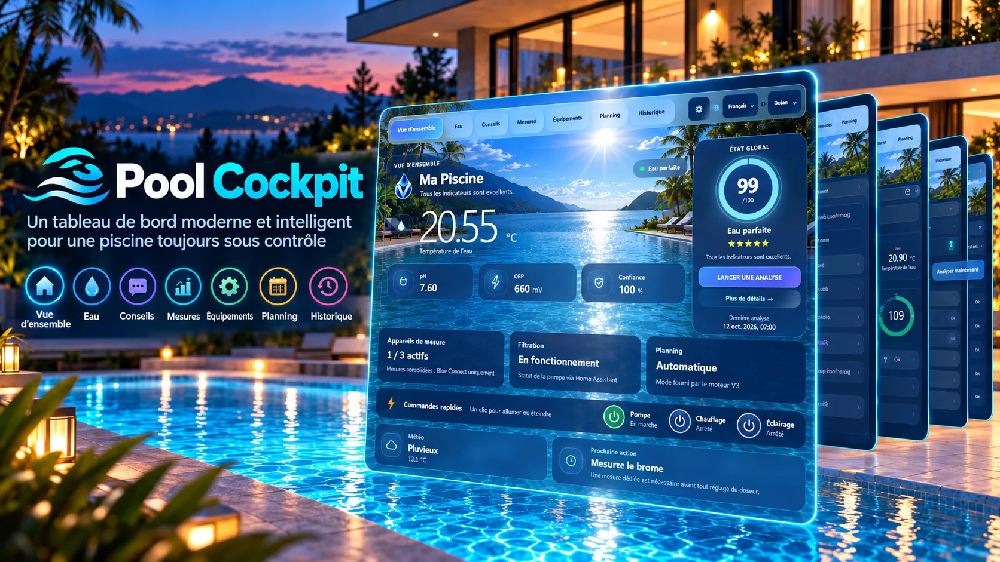
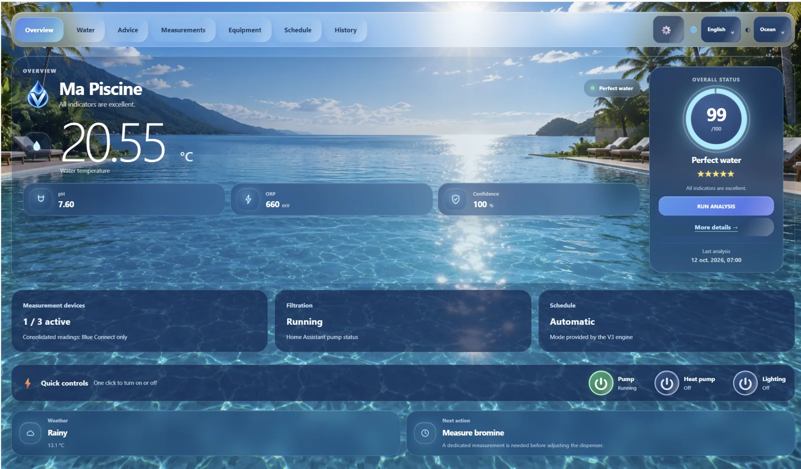
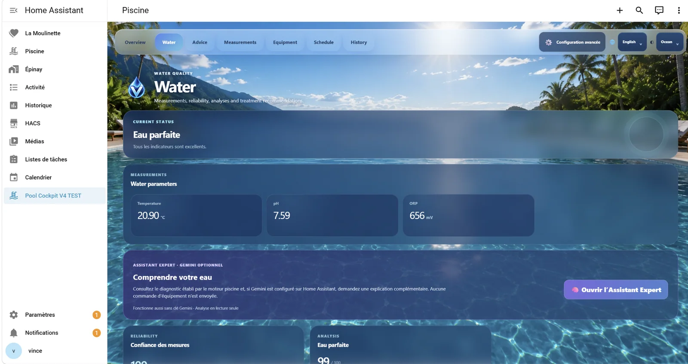
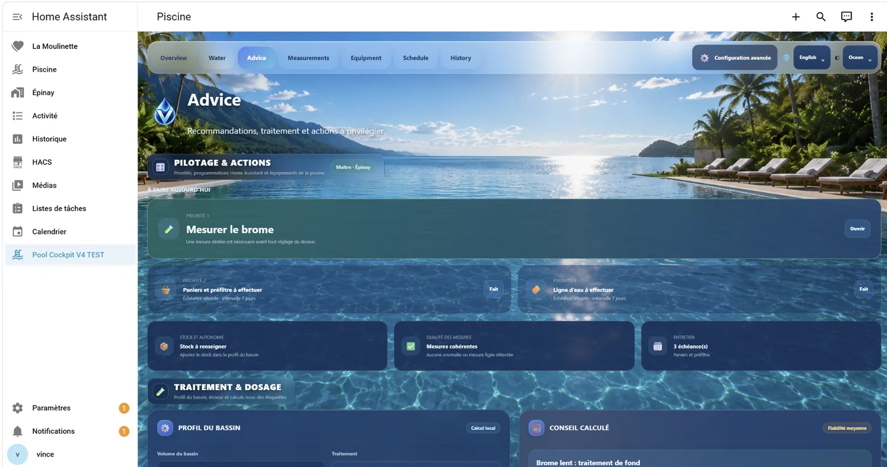
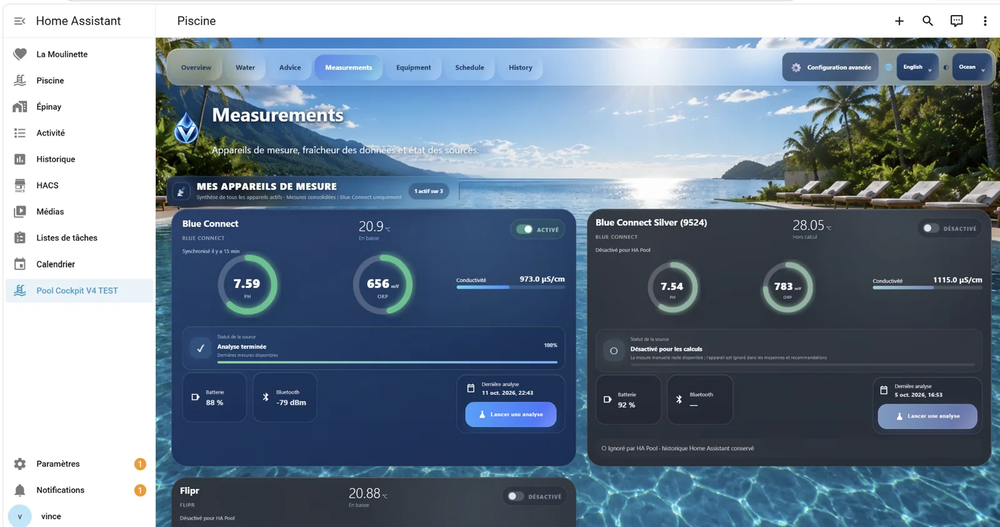
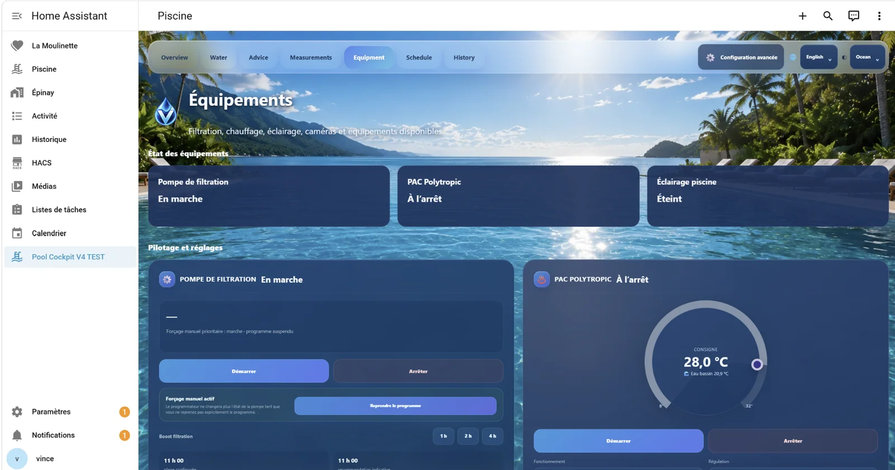
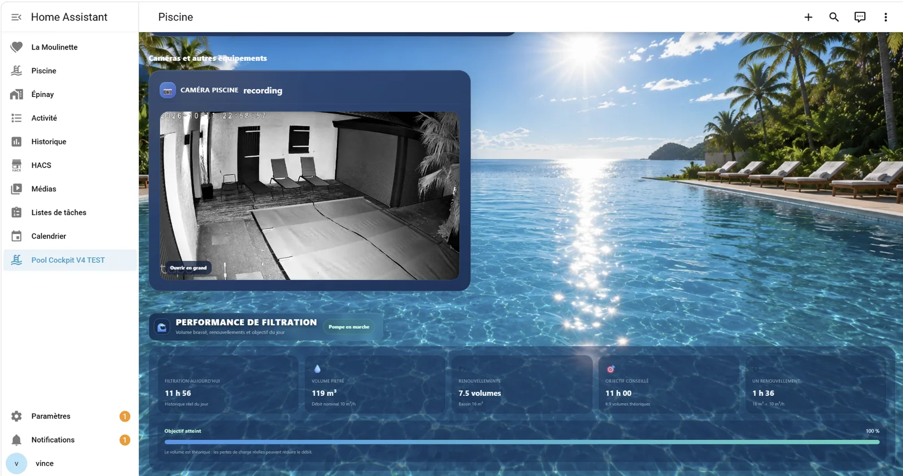

<div align="center">

# 🌊 Pool Cockpit V4 — Version candidate RC1

**Votre piscine. Un cockpit élégant.**  
*Un tableau de bord moderne pour surveiller, analyser et piloter votre piscine dans Home Assistant.*

[**English**](README.md) · [**Français**](README.fr.md)

  



<sub>Illustration promotionnelle inspirée de la V4 ; les captures réelles figurent ci-dessous.</sub>

</div>

## Découvrez la véritable interface

Le thème Océan réunit la qualité de l'eau, les conseils, les mesures, les équipements et leur programmation. Les images suivantes sont **de vraies captures de l'application**, et non des rendus publicitaires générés.

### Vue d'ensemble



### Eau · Conseils · Mesures

| Qualité de l'eau | Conseils contextualisés |
|:---:|:---:|
|  |  |



### Équipements · Planning

| Pilotage des équipements | Programmation |
|:---:|:---:|
|  |  |

**Historique** constitue le septième espace de la V4. Une capture à jour sera ajoutée après validation finale.

## Fonctionnalités principales

- **Interface Océan :** décor immersif, cartes translucides et typographie harmonisée.
- **Qualité de l'eau :** température, pH, ORP, confiance et état global.
- **Commandes rapides compactes :** pompe, PAC et éclairage, avec maintien des sécurités existantes.
- **Conseils utiles :** recommandations, mesures et opérations d'entretien.
- **Suivi des analyses :** étapes contextualisées sans pourcentage de progression fictif.
- **Neuf langues proposées :** français, anglais, allemand, espagnol, portugais brésilien, italien, néerlandais, japonais et chinois simplifié. Certaines traductions restent à compléter.
- **Interface responsive :** ordinateur et smartphone.

## Installation de la V4 RC1

> **Préversion.** La V3 reste la version stable sur `main`. La RC1 est distribuée uniquement sur la branche `release/v4-rc1` et nécessite une installation Home Assistant / Pool Cockpit compatible.

1. Dans `release/v4-rc1/`, vérifiez l'empreinte SHA-256 du fichier `pool-dashboard-v4-test.js` :

   ```text
   49a5faf55bc3850232b97c996832c7cf85a94cdea253c802c8011edfeb13578c
   ```

2. Sauvegardez le **JavaScript de test V4** actuel, puis installez le nouveau fichier et le logo `pool-cockpit-v4-logo.png` dans `/config/www/ha-pool-dashboard/` (ou son chemin côté hôte). **Ne remplacez jamais la ressource V3.**
3. Dans les ressources Lovelace, choisissez le type **Module JavaScript** avec l'URL :

   ```text
   /local/ha-pool-dashboard/pool-dashboard-v4-test.js?v=v4.0.0-rc.1
   ```

4. Actualisez le navigateur et vérifiez les entités et commandes d'équipement. Pour revenir en arrière, restaurez votre sauvegarde JavaScript V4.

## État de la RC1 et précautions

Le bundle RC1 publié est encore différent du bundle `frontend/dist/pool-dashboard.js` généré depuis les sources. La réconciliation du code, certains textes métier V3 non traduits et la recette réelle des équipements restent à terminer avant la V4 stable. Cette interface ne remplace pas les automatismes ni les sécurités Home Assistant.

Ne publiez aucun jeton, mot de passe, identifiant d'équipement ou donnée de télémétrie sensible. Les illustrations promotionnelles ne constituent pas une garantie de fonctionnement.

**Licence :** PolyForm Noncommercial 1.0.0.  
**[V3 stable](https://github.com/vinzgithub/ha-pool-cockpit/tree/main)** · **[Release V4 RC1](https://github.com/vinzgithub/ha-pool-cockpit/releases/tag/v4.0.0-rc.1)**
