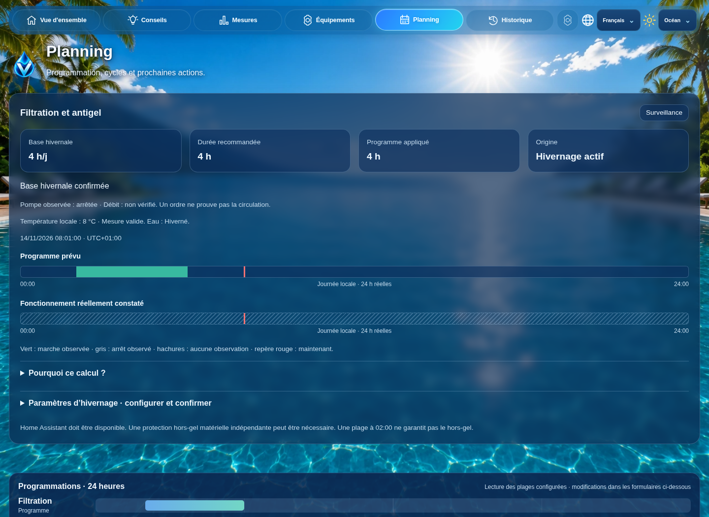

<div align="center">

# 🌊 Pool Cockpit

### Votre piscine, un seul cockpit. Au printemps, en été, en automne et en hiver.

**Mesures · Filtration · Traitement · PAC · Météo · Conseils · Planning · Hivernage**

[**🇬🇧 English**](README.md) · [**Français**](README.fr.md)

  


<sub>La planche graphique originale de Pool Cockpit, conservée pour l'identité visuelle du projet. Les vraies captures d'écran de la V4.3.0 figurent plus bas, dans la galerie.</sub>

**[Fonctionnalités](#toutes-les-fonctionnalités-expliquées-simplement)** · **[Quatre saisons](#une-piscine-quatre-saisons)** · **[Captures](#découvrez-linterface)** · **[Installation](#installer-en-trois-étapes)**

</div>

---

## Une piscine connectée, sans multiplier les applications

Température de l’eau dans une application, filtration dans une autre, pompe à chaleur ailleurs… **Pool Cockpit réunit dans Home Assistant les informations et les outils utiles pour suivre votre piscine toute l’année.**

Au printemps, vous remettez votre bassin en route. En été, vous suivez la qualité de l’eau et la filtration. En automne, vous adaptez les durées. En hiver, vous gérez l’hivernage si vous choisissez ce mode. **Le tout sur ordinateur, tablette ou téléphone.**

> **Vous découvrez Home Assistant ?** C'est le logiciel qui réunit vos appareils connectés. Pool Cockpit ajoute une interface claire pour suivre votre piscine. Les équipements doivent déjà être reliés à Home Assistant par les intégrations adaptées.

### En pratique, qu'est-ce que je peux faire ?

| Rubrique | À quoi ça sert ? |
| --- | --- |
| 🏠 **Vue d'ensemble** | Savoir rapidement comment va ma piscine |
| 💡 **Conseils** | Comprendre ce qui mérite mon attention |
| 🧪 **Mesures** | Consulter la température, le pH ou le Redox (ORP) disponibles |
| ⚙️ **Équipements** | Suivre la pompe, la PAC, les sondes et leur état |
| 📅 **Planning** | Comprendre les horaires de filtration, les conseils et la durée appliquée |
| 🕘 **Historique** | Retrouver les événements et les évolutions de mesure |

Les informations disponibles dépendent des appareils et des entités configurés chez vous.

## Une piscine, quatre saisons

Pool Cockpit n’est **pas une application réservée à l’hivernage**. Son fonctionnement quotidien reste au cœur du projet :

| Saison | Comment Pool Cockpit vous accompagne |
| :--- | :--- |
| 🌱 **Printemps** | Retrouvez les nouvelles mesures des sondes après remise en service, contrôlez la pompe et la PAC, puis réajustez votre planning. |
| ☀️ **Été** | Surveillez température, pH et Redox, consultez les conseils de filtration, notez les traitements et gardez un œil sur la météo et la fréquentation déclarée. |
| 🍂 **Automne** | Comparez les durées recommandées à vos horaires, accompagnez le refroidissement de l’eau et préparez les équipements à leur arrêt saisonnier. |
| ❄️ **Hiver** | Choisissez, si nécessaire, un hivernage actif, indiquez les appareils hivernés et surveillez le risque de gel avec une sonde locale adaptée. |

La **saison est un repère**, pas un ordre. Le calcul de filtration tient aussi compte de la température de l’eau, du contexte disponible et de vos paramètres. Le logiciel respecte les choix manuels et les dispositifs de sécurité.

## Toutes les fonctionnalités, expliquées simplement

### 🧪 Mesures de l’eau : connaître l’état de son bassin

**À quoi ça sert ?** Réunir vos mesures plutôt que de passer d’une application à l’autre.

Pool Cockpit peut présenter la **température de l’eau**, le **pH**, le **Redox (ORP)** et, si votre équipement les fournit, d’autres valeurs comme la conductivité, la salinité ou le chlore libre. Il peut afficher plusieurs analyseurs, la date de la dernière analyse, la fraîcheur des données et certaines informations de connexion ou de batterie.

**Équipements compatibles :** les familles **Blue Connect / Blueriiot / Zodiac compatibles** et **Flipr** peuvent être détectées lorsque leurs entités existent déjà dans Home Assistant. Selon le matériel, une analyse manuelle peut aussi être disponible. Aucune sonde n’est imposée pour utiliser le mode Démonstration.

*Exemple :* après avoir remis une sonde à l’eau au printemps, vérifiez l’arrivée d’une **nouvelle mesure** avant de vous fier au chiffre affiché.

### 🔄 Filtration : comprendre les besoins et les performances

**À quoi ça sert ?** Savoir combien de temps filtrer et comprendre ce qui est effectivement programmé.

- Une **durée conseillée** selon les informations disponibles : saison, température de l’eau, paramètres du bassin et contexte pertinent.
- La distinction entre **durée recommandée**, **durée programmée** et **fonctionnement réellement observé**, quand celui-ci peut être remonté par Home Assistant.
- Un bilan de la journée avec, selon la configuration, durée de filtration, **volume filtré estimé** et nombre estimé de renouvellements du bassin.
- Un **repli prudent** quand une sonde est absente ou que sa mesure est trop ancienne.

*Exemple :* en période chaude, un besoin de filtration plus élevé peut être proposé ; lorsque l’eau refroidit, la recommandation peut diminuer. Une estimation de volume n’est pas une mesure réelle du débit en l’absence de débitmètre.

### 📅 Planning : automatiser, personnaliser ou reprendre la main

**À quoi ça sert ?** Organiser la filtration sans perdre vos choix.

- **Programme adaptatif** : les plages proposées suivent les règles et les données connues.
- **Horaires personnalisés** : choisissez vous-même jours et créneaux ; un recalcul ne doit pas écraser vos modifications.
- **Suspension du mode adaptatif** : conservez les plages actuelles jusqu’à votre décision de reprendre.
- **Prolongation ponctuelle** : ajoutez du temps sans réécrire la programmation permanente.
- **Forçage manuel** de la pompe, lorsque l’équipement et les sécurités sont correctement configurés, avec reprise explicite du programme.
- **Profils saisonniers** (printemps, été, automne, hiver), utiles comme références mais jamais comme durées universelles.

*Exemple :* après une journée de baignade intense, vous pouvez ajuster la filtration sans perdre le programme habituel.

### 🧴 Traitement de l’eau et dosages : des repères pour l’entretien

**À quoi ça sert ?** Comprendre les informations utiles avant d’ajouter un produit, puis garder une trace.

L’espace **Traitement & dosage** utilise le profil renseigné de votre piscine : volume, désinfectant, caractéristiques de filtration, état visuel de l’eau, fréquentation déclarée et mesures disponibles. Il peut proposer des **repères de dosage** liés au chlore ou au brome, au pH, aux produits complémentaires et, selon les données, au TAC ou à la dureté. Le **journal des traitements** conserve les opérations saisies.

Les produits complémentaires peuvent être gérés à la demande ou selon un protocole fabricant choisi explicitement. **Pool Cockpit ne dose ni n’injecte automatiquement de produits chimiques.** Vérifiez toujours les notices, les analyses réelles et les conditions du bassin.

### 🌡️ Pompe à chaleur : suivi Polytropic et autres modèles

**À quoi ça sert ?** Voir les informations de votre PAC dans le même cockpit que la filtration.

Le module PAC a été **développé à partir d’une installation de référence équipée d’une pompe à chaleur Polytropic**, reliée à Home Assistant. Il s’appuie sur des **entités Home Assistant à associer** : état de fonctionnement, consigne, modes disponibles, températures d’entrée et de sortie, état de communication et défauts, lorsqu’ils sont exposés.

**Autres marques :** le suivi est **potentiellement utilisable** avec une autre PAC si une intégration Home Assistant fournit des entités équivalentes. Cette compatibilité doit être vérifiée **modèle par modèle** : il ne s’agit **ni d’une découverte universelle ni d’une certification de toutes les PAC**.

**Sécurité :** les commandes d’écriture vers la PAC restent **verrouillées dans la version publique V4.3.0**. Le suivi de son état ne signifie pas que Pool Cockpit peut changer sa consigne ou la démarrer.

### 🌦️ Météo, vigilances et conseils

**À quoi ça sert ?** Voir les informations qui peuvent modifier la surveillance ou les recommandations.

Pool Cockpit exploite les **entités météo disponibles dans Home Assistant** et peut afficher les **vigilances Météo-France**. Selon les mesures et déclarations disponibles, les conseils peuvent prendre en compte la chaleur, la fréquentation ou l’état de l’eau. Une vigilance ou une température extérieure distante **ne remplace pas une mesure locale** pour la sécurité antigel.

### 📈 Historique, suivi et Assistant Expert

**À quoi ça sert ?** Comprendre ce qui s’est passé et pourquoi un conseil apparaît.

Consultez les tendances et événements disponibles, retrouvez votre **journal de traitement** et les informations d’activité prises en charge. L’**Assistant Expert Piscine** explique des conclusions déjà calculées sur la filtration, la météo, le traitement ou la PAC. Une reformulation par IA peut être proposée **uniquement si elle est configurée** ; elle **n’invente pas les règles et ne commande aucun équipement**.

### 🎨 Interface, thèmes, langues et démonstration

Le tableau de bord regroupe six rubriques : **Vue d’ensemble, Conseils, Mesures, Équipements, Planning et Historique**. Il s’adapte au mobile, propose plusieurs thèmes dont **Océan**, et différentes langues.

- **Mode Réel** : les informations viennent des entités configurées dans votre Home Assistant.
- **Mode Démonstration** : des valeurs fictives permettent d’explorer le cockpit **sans toucher aux équipements physiques**.
- **Multi-instance** : une configuration maître/satellite est possible pour les utilisateurs avancés ; **elle n’est pas nécessaire** pour une piscine domestique.

### ❄️ Hivernage actif : la nouveauté V4.3.0

En hiver, vous pouvez choisir un mode d’**hivernage actif**, déclarer séparément la PAC et les sondes hivernées, conserver votre programmation normale et configurer une surveillance antigel **avec une vraie sonde locale**. Le statut **Maintenance** permet de signaler une intervention sur le circuit.

**L’antigel est désactivé par défaut après migration.** Cette fonction logicielle ne garantit pas le hors-gel si l’alimentation électrique, Home Assistant, la pompe ou la circulation d’eau tombent en panne. [Voir le guide hivernage et ses précautions](release/v4.3.0/README.md).


## ✨ Ce qui change spécifiquement en V4.3.0

**Toutes les fonctionnalités des saisons chaudes sont conservées.** La V4.3.0 ajoute principalement :

- Les modes **Normal**, **Hivernage actif** et **Maintenance**, avec confirmation et conservation du programme précédent.
- La surveillance antigel **à partir d’une sonde locale**, avec seuils ajustables, délais et priorités de sécurité.
- Des **statuts d’équipements plus clairs** : disponibilité, commande demandée, fonctionnement observé et débit vérifié uniquement si un débitmètre existe.
- Des cartes compactes dans **Vue d’ensemble** et **Équipements**, et des frises plus lisibles dans **Planning**.
- Un **installateur simplifié**, avec sauvegarde et retour arrière pour les installations reconnues.

**Important :** l’antigel n’est pas une protection matérielle autonome. [Précautions et fonctionnement détaillé](release/v4.3.0/README.md).

## Découvrez l'interface

Ces images sont de **vraies captures du tableau de bord V4.3.0**, obtenues sur une installation Home Assistant de recette avec des appareils simulés.

| Vue d'ensemble — l'essentiel en un coup d'œil | Planning — comprendre les horaires et la filtration |
| :---: | :---: |
|  |  |

| Équipements — des états indépendants | Mobile — la même interface, plus compacte |
| :---: | :---: |
|  |  |

Le **thème Océan** est présenté ici ; d'autres thèmes et langues sont disponibles. Retrouvez d'autres captures et les choix d'ergonomie dans le [bilan UX V4.3.0](release/v4.3.0/UX_REVIEW.md).

## 🏊 Votre piscine ou 🎮 une démonstration ?

| | Mode Réel | Mode Démonstration |
| --- | --- | --- |
| **Faut-il une piscine équipée ?** | Oui, pour les vraies mesures | Non |
| **Faut-il Home Assistant ?** | Oui | Oui |
| **D'où viennent les données ?** | De vos équipements déclarés dans Home Assistant | De valeurs fictives |
| **La démo peut-elle agir sur une vraie pompe ?** | Sans objet | **Jamais** |

**Mode Réel :** Pool Cockpit utilise les données de vos intégrations Home Assistant. Par exemple, les projets indépendants [Blue Connect Local](https://github.com/Adrien40/ha-blue-connect-local) et [Flipr Local](https://github.com/Adrien40/ha-flipr-local) peuvent fournir les informations de ces sondes. **Ils ne sont pas inclus dans Pool Cockpit** et ne sont utiles que si vous disposez de ces appareils.

**Mode Démonstration :** explorez les écrans et les données fictives, sans matériel de piscine. Ce mode ne simule pas une protection antigel réelle.

## Installer en trois étapes

La V4.3.0 prend en charge les installations **Home Assistant Core / Docker** disposant d'un accès au dossier contenant le fichier `configuration.yaml`. Il faut Python 3, Git et une **sauvegarde complète de Home Assistant**. L'installation ne passe **pas par HACS**.

**1. Récupérer Pool Cockpit**

```bash
git clone https://github.com/vinzgithub/ha-pool-cockpit.git
cd ha-pool-cockpit
```

**2. Vérifier avant de modifier quoi que ce soit**

```bash
sh install.sh --config /chemin/vers/homeassistant/config --dry-run
```

**3. Sauvegarder Home Assistant, l'arrêter, puis installer**

```bash
sh install.sh --config /chemin/vers/homeassistant/config --yes
```

**Redémarrez ensuite Home Assistant manuellement**, puis actualisez le navigateur. Le tableau de bord **Piscine / Pool Cockpit** apparaît dans Home Assistant.

L'installateur reconnaît une **installation neuve** ou une **V4.2.1 officielle**. Il sauvegarde les fichiers et les paramètres avant une mise à jour. S'il ne reconnaît pas votre installation, il **refuse d'écraser les fichiers**. Il ne redémarre ni n'arrête automatiquement Home Assistant.

**Vous utilisez une autre version ou Home Assistant OS ?** Lisez d'abord le [guide d'installation et de restauration](docs/user/INSTALLATION.md). Ne forcez pas une mise à jour non reconnue.

## Trois exemples concrets

**🌱 Au printemps :** après la remise en service, vous vérifiez les nouvelles mesures, l’état de la pompe et la programmation.

**☀️ En été :** après plusieurs journées chaudes et fréquentées, vous consultez la durée recommandée, ajustez si nécessaire le planning et consignez le traitement effectué.

**❄️ En hiver :** si vous choisissez l’hivernage actif, vous validez une programmation réduite et contrôlez les alertes. La protection antigel dépend de la sonde locale et de sécurités physiques toujours opérationnelles.

## Questions fréquentes

<details>
<summary><strong>Pool Cockpit va-t-il effacer ma configuration Home Assistant ?</strong></summary>

Non, une mise à jour reconnue depuis la V4.2.1 conserve le tableau de bord et les paramètres existants. Une sauvegarde datée est créée auparavant. Comme la V4.3.0 modifie le backend Python et le stockage, suivez la procédure d'arrêt et de redémarrage documentée.

</details>

<details>
<summary><strong>Faut-il absolument acheter une sonde Blue Connect ou Flipr ?</strong></summary>

Non. Ces appareils sont facultatifs. Pool Cockpit peut utiliser les entités d'autres intégrations compatibles, et le mode Démonstration fonctionne sans matériel de piscine.

</details>

<details>
<summary><strong>Le mode hivernage garantit-il que ma piscine ne gèlera pas ?</strong></summary>

Non. Une filtration quotidienne réduite ne garantit pas le hors gel. La protection antigel logicielle dépend aussi du capteur local, de Home Assistant, de l'électricité, de la pompe et de la circulation. Il faut respecter les recommandations du fabricant et prévoir une protection adaptée à l'installation.

</details>

<details>
<summary><strong>Et si je veux revenir à la version précédente ?</strong></summary>

Arrêtez Home Assistant. L'installateur indique le chemin de la sauvegarde et propose une option `--rollback`. Il faut **restaurer ensemble** le JavaScript, le backend Python et les données antérieures à la migration. Consultez la [procédure de retour arrière](docs/user/INSTALLATION.md).

</details>

## Pour aller plus loin

**[Guide détaillé des fonctionnalités](docs/user/DASHBOARD.md)** · **[Releases GitHub](https://github.com/vinzgithub/ha-pool-cockpit/releases)** · **[Guide hivernage V4.3.0](release/v4.3.0/README.md)** · **[Installation et retour arrière](docs/user/INSTALLATION.md)** · **[Tests et limites](release/v4.3.0/TEST_REPORT.md)** · **[Documentation en anglais](README.md)**

**Confidentialité et sécurité :** ne publiez pas vos identifiants, tokens ou données privées Home Assistant. Pool Cockpit ne remplace ni les sécurités électriques et hydrauliques, ni la surveillance humaine, ni l'entretien de la piscine. Toute commande réelle doit être validée sur votre installation.

**Licence :** [PolyForm Noncommercial 1.0.0](LICENSE). L'utilisation commerciale reste soumise aux termes de la licence.

---

<div align="center">
<sub>🌊 Pool Cockpit V4.3.0 · Home Assistant · Votre piscine, votre cockpit.</sub>
</div>
