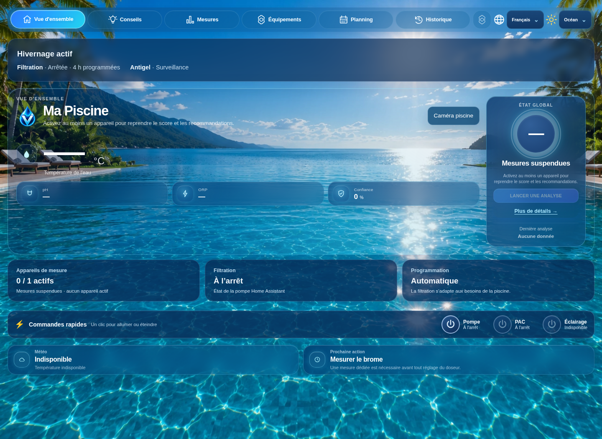
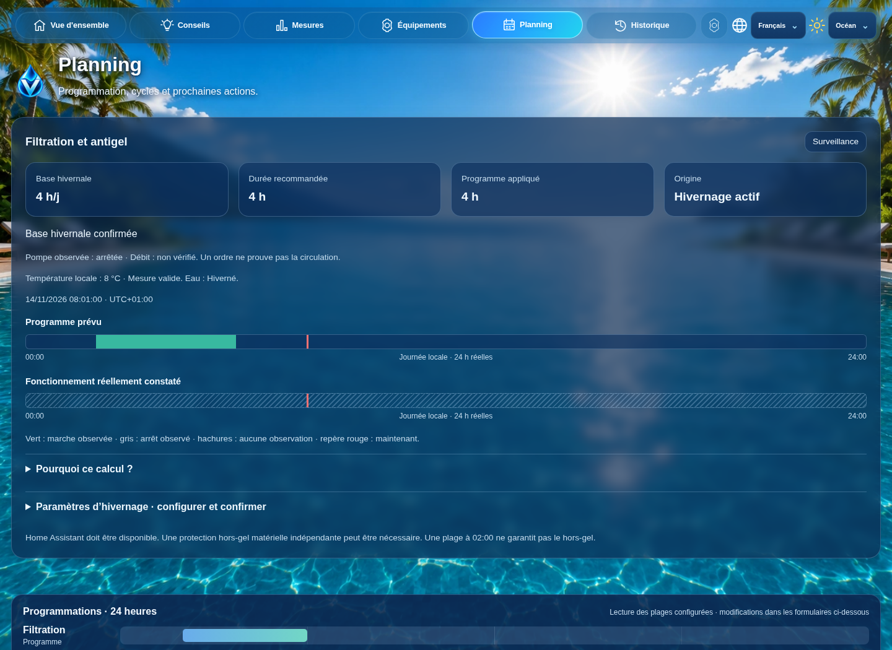
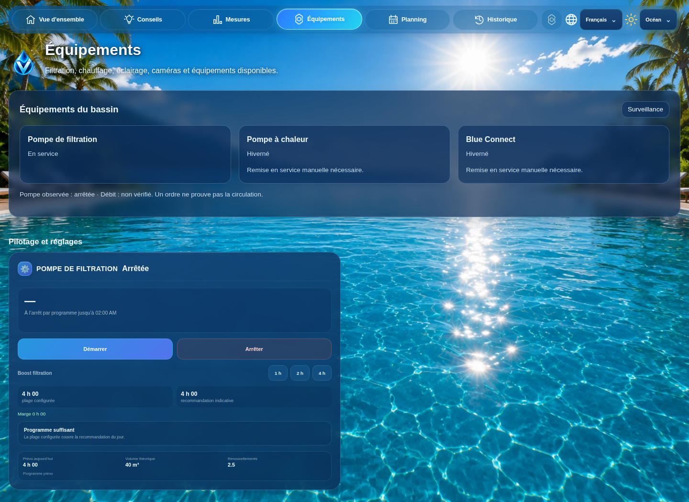
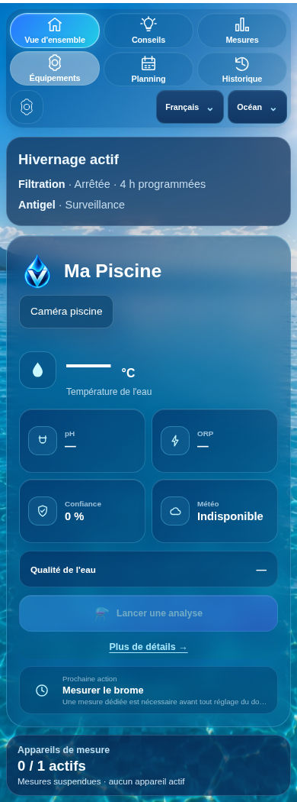

<div align="center">

# 🌊 Pool Cockpit

### A clearer view of your pool. All in Home Assistant.

**Water quality · Filtration · Heat pump · Weather · Planning · Active wintering**

[**English**](README.md) · [**🇫🇷 Français**](README.fr.md)

  



<sub>A real browser screenshot of the V4.3.0 interface, using simulated test devices. Not a photograph or a live pool reading.</sub>

**[Get started](#get-started-in-three-steps)** · **[Discover wintering](#wintering-made-understandable)** · **[Explore the interface](#take-a-look)** · **[Français](README.fr.md)**

</div>

---

## Your pool deserves one simple dashboard

Pool equipment often lives in different apps: one for water quality, one for a heat pump, another for home automation. **Pool Cockpit brings the information already available in Home Assistant into a single, easy-to-read screen.**

You can check your water measurements, understand filtration recommendations, see whether equipment is running, and review your schedule without jumping between interfaces.

> **New to Home Assistant?** Think of Home Assistant as the hub that talks to your connected devices. Pool Cockpit is the friendly dashboard that helps you understand their information. It does not replace their integrations.

### What can I see?

| Section | What it tells you |
| --- | --- |
| 🏠 **Overview** | Is everything okay with my pool? |
| 💡 **Advice** | What should I pay attention to today? |
| 🧪 **Measurements** | What are my water temperature, pH and ORP readings, when available? |
| ⚙️ **Equipment** | What are my pump, heat pump and connected probes doing? |
| 📅 **Planning** | When is filtration scheduled, and how does that compare with the recommendation? |
| 🕘 **History** | What changed, and when? |

What you see depends on the devices and entities configured in your Home Assistant installation.

## ✨ What's new in V4.3.0?

### Winter mode, without losing your usual settings

When swimming season ends, you may want a shorter filtration schedule and to put some devices away for winter. V4.3.0 introduces three explicit modes:

- **Normal:** your regular pool schedule and equipment settings.
- **Active wintering:** a separately confirmed winter filtration schedule, with equipment wintering states.
- **Maintenance:** an explicit state to prevent unintended circulation during maintenance.

For example, you can confirm **4 hours from 02:00 to 06:00** for wintering. That's a *suggestion*, not a universal frost-protection guarantee. Your previous program is kept so it can be restored when you return to Normal.

### Frost monitoring that explains what is happening

With a suitable **local temperature sensor**, Pool Cockpit can ask the filtration pump to run when temperatures approach freezing, even outside normal filtration hours. By default, the proposed thresholds are **3 °C to start and 5 °C to release**, with delays to avoid rapid on/off cycling.

It also explains whether:
- frost protection has **requested** circulation;
- Home Assistant has **observed** the pump running;
- real **water flow is verified** — only when you have a configured flow sensor.

Hydraulic safety locks always take priority. An unavailable sensor triggers a warning; it cannot magically verify that the equipment is safe.

**Important:** this is a software monitoring and control aid, **not a certified autonomous frost-protection system**. It cannot protect the pool if Home Assistant, electricity, the pump or the hydraulic circuit fails. Frost monitoring is **off by default** and must only be enabled after checking the real installation and safety devices. For prolonged absences, independent physical freeze protection or appropriate passive wintering may be necessary.

### Put each device into winter storage separately

The heat pump, Blue Connect and Flipr can be marked as winterized individually. Pool Cockpit stops relying on winterized probes for fresh water readings. **Each device must be reactivated explicitly**; reactivating a probe also requires a new measurement before its data is trusted.

Heat-pump commands remain **disabled by default**.

## Take a look

These are genuine V4.3.0 browser captures from the isolated test setup using **simulated devices**.

| Overview — calm, at-a-glance status | Planning — understand scheduled vs. observed filtration |
| :---: | :---: |
|  |  |

| Equipment — each device has its own status | Mobile — the same cockpit on smaller screens |
| :---: | :---: |
|  |  |

The Ocean theme is shown here. Other themes and language options are available. See the [V4.3.0 design review](release/v4.3.0/UX_REVIEW.md) for more screenshots.

## 🏊 Real pool or 🎮 Demonstration?

| | Real pool | Demonstration |
| --- | --- | --- |
| **Need physical pool hardware?** | Yes, to display real readings | No |
| **Need Home Assistant?** | Yes | Yes |
| **Where does the data come from?** | Your configured HA entities | Fictional sample values |
| **Can demo controls operate equipment?** | Not applicable | **Never** |

**Real mode** uses information from compatible Home Assistant integrations. For example, the independent [Blue Connect Local](https://github.com/Adrien40/ha-blue-connect-local) and [Flipr Local](https://github.com/Adrien40/ha-flipr-local) integrations may supply data for their respective devices. They are **not included in Pool Cockpit**, and you do not need them unless you own the hardware.

**Demonstration mode** is a safe way to discover the dashboard before connecting any equipment. It does not pretend to provide real frost protection.

## Get started in three steps

Pool Cockpit V4.3.0 supports **Home Assistant Core / Docker** installations where you can access the directory containing `configuration.yaml`. You need Python 3, Git and a full Home Assistant backup. It is **not installed through HACS**.

**1. Get the project**

```bash
git clone https://github.com/vinzgithub/ha-pool-cockpit.git
cd ha-pool-cockpit
```

**2. Check the installation — without changing anything**

```bash
sh install.sh --config /path/to/homeassistant/config --dry-run
```

**3. Back up Home Assistant, stop it, and install**

```bash
sh install.sh --config /path/to/homeassistant/config --yes
```

Then **restart Home Assistant manually** and refresh your browser. Look for the **Piscine / Pool Cockpit** dashboard.

The installer recognizes either a **fresh installation** or an **official V4.2.1 installation**. It makes a dated backup before changing existing files, preserves your settings, and refuses unfamiliar or modified installations instead of overwriting them. It does **not** stop or restart Home Assistant itself.

**Already running another version, or using Home Assistant OS?** Read the [installation, compatibility and rollback guide](docs/user/INSTALLATION.md) before doing anything.

## Wintering made understandable

**Example — a mild November day:** you confirm a reduced filtration schedule and separately mark your heat pump and probes as winterized. Your normal schedule is preserved.

**Example — a cold night:** if your configured *local* sensor reports a sufficiently low temperature, the software can request additional pump circulation **outside the normal program**, provided the hydraulic safety checks allow it. The dashboard shows that request and what HA has actually observed.

**Example — a problem:** if the temperature becomes stale, the pump cannot start, or flow is absent, the dashboard reports that protection is not confirmed. It does not claim everything is safe.

For the exact thresholds, delays, confirmation steps, priorities and limitations, consult the [V4.3.0 wintering guide](release/v4.3.0/README.md).

## Frequently asked questions

<details>
<summary><strong>Will Pool Cockpit replace my existing Home Assistant setup?</strong></summary>

No. On a recognized V4.2.1 upgrade, it preserves your dashboard configuration and Pool Cockpit data. A versioned backup is created first. Because V4.3.0 also updates the Python integration and storage schema, use the installer and follow the documented stop/restart procedure.

</details>

<details>
<summary><strong>Do I need a Blue Connect, Flipr, or a heat pump?</strong></summary>

No. Those devices are optional. Use the entities your own compatible Home Assistant integrations provide. You can also explore without hardware in Demonstration mode.

</details>

<details>
<summary><strong>Does activating winter mode guarantee my pool will not freeze?</strong></summary>

No. A shorter daily filtration period alone does not guarantee frost protection. The optional software frost feature also depends on a real local sensor, working Home Assistant, power, pump and safe water circulation. A suitably installed physical protection system and manufacturer instructions remain important.

</details>

<details>
<summary><strong>How do I undo a V4.3.0 upgrade?</strong></summary>

Stop Home Assistant first. The installer records a dated backup path and provides a `--rollback` option. **Restore the JavaScript, Python backend and storage together**, not only one part. See the [rollback instructions](docs/user/INSTALLATION.md).

</details>

## Further reading

**[GitHub Releases](https://github.com/vinzgithub/ha-pool-cockpit/releases)** · **[V4.3.0 technical guide](release/v4.3.0/README.md)** · **[Installation and rollback](docs/user/INSTALLATION.md)** · **[Tests and limitations](release/v4.3.0/TEST_REPORT.md)** · **[French documentation](README.fr.md)**

**Privacy and safety:** keep Home Assistant credentials and private device identifiers out of issues and screenshots. Pool Cockpit is not a substitute for professional pool maintenance, electrical protection or physical hydraulic interlocks. Real equipment commands must be checked against your installation.

**License:** [PolyForm Noncommercial 1.0.0](LICENSE). Commercial use is subject to its terms.

---

<div align="center">
<sub>🌊 Pool Cockpit V4.3.0 · Home Assistant · A simpler way to understand your pool.</sub>
</div>
