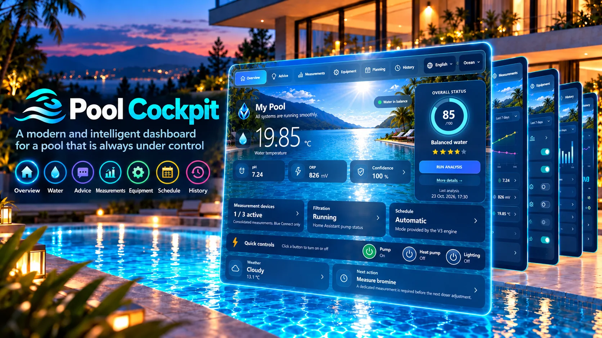
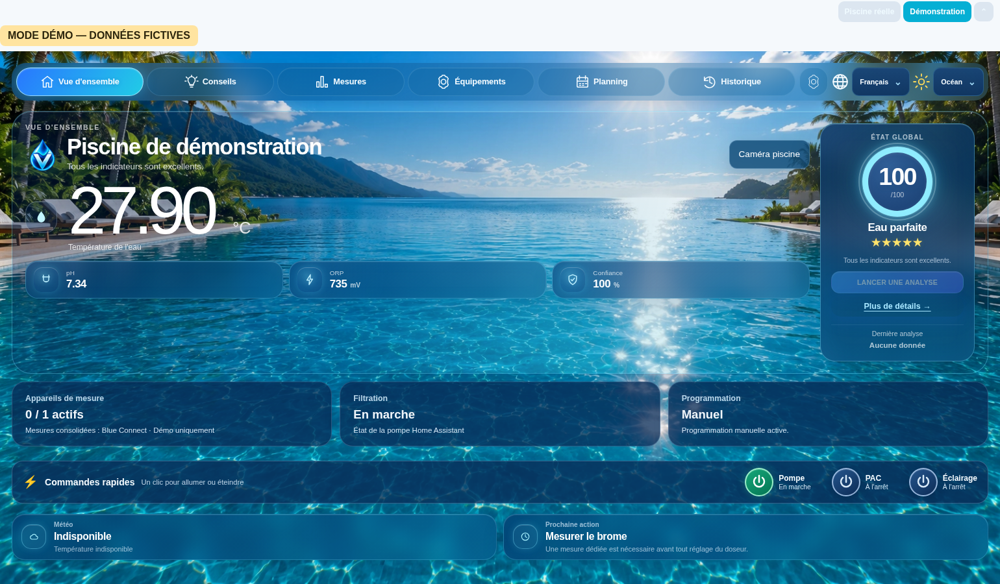
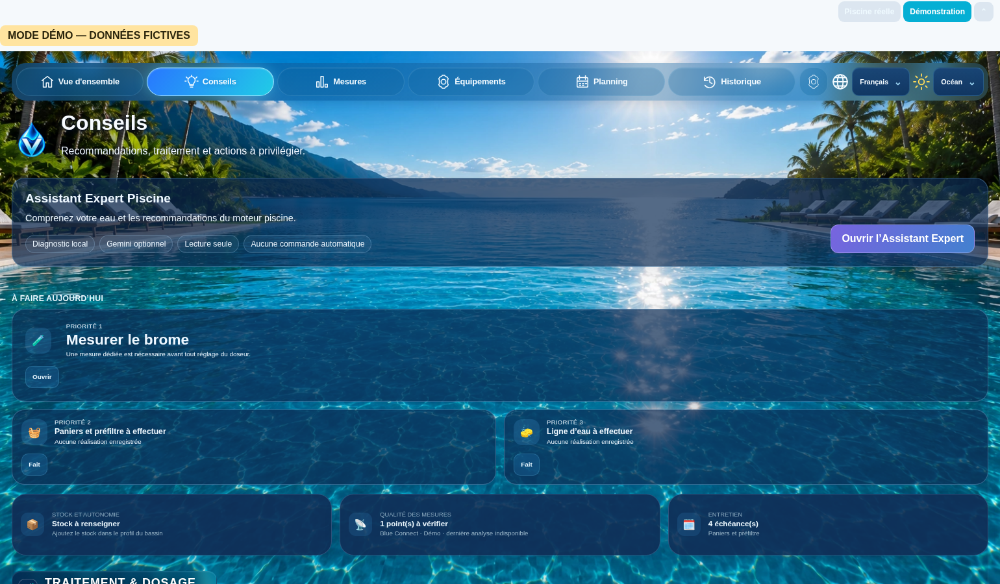
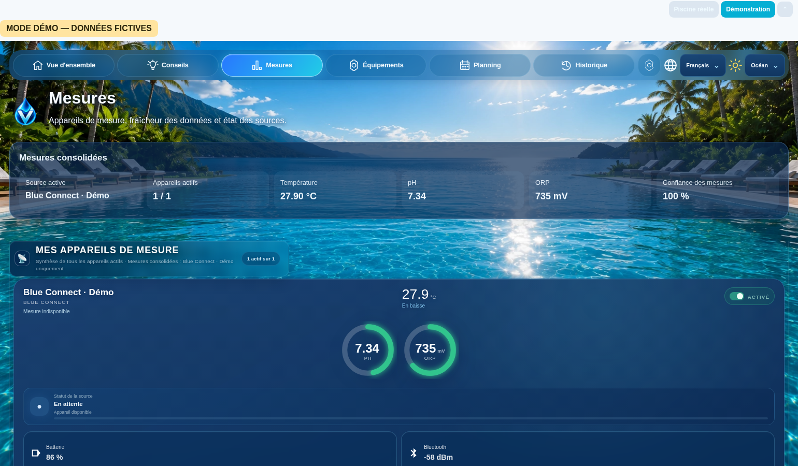
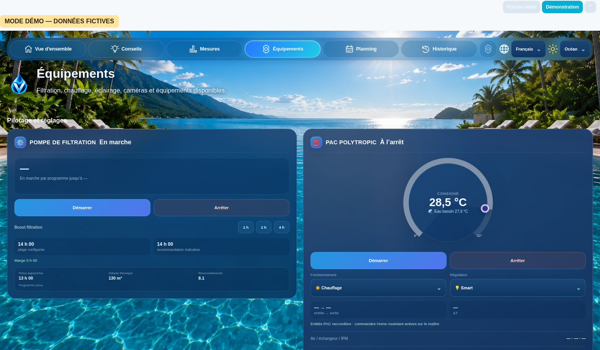
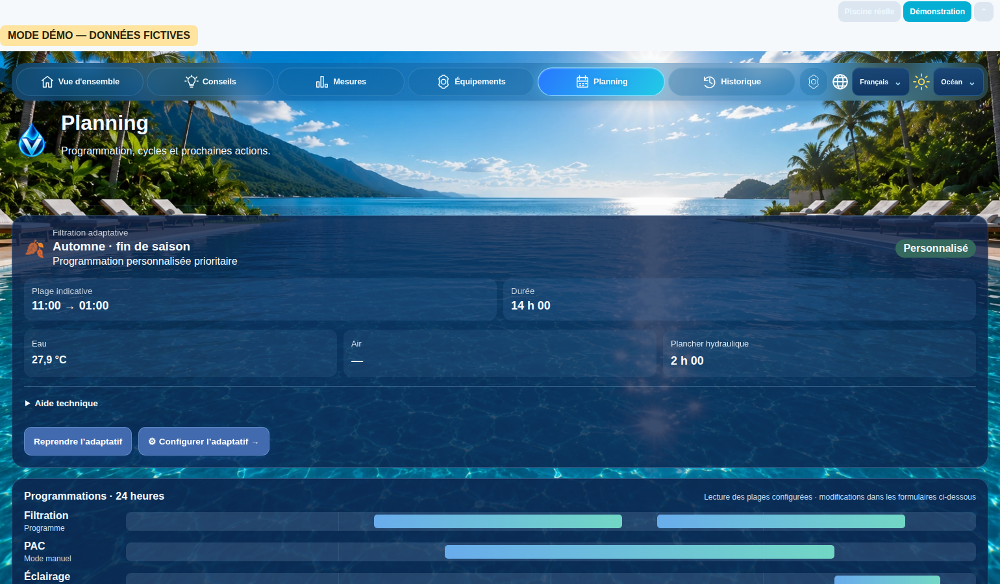
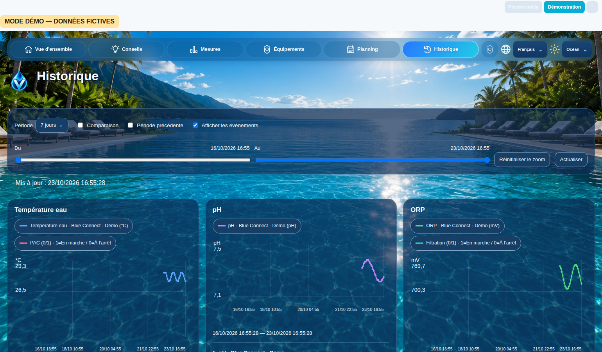

<div align="center">

# 🌊 Pool Cockpit V4.2.0

### Your pool. One elegant cockpit.

**Monitoring · Advice · Measurements · Equipment · Planning · History**

**English** · [**Français**](README.fr.md)

  



<sub>Pool Cockpit promotional illustration; see current V4.2.0 interface screenshots below.</sub>

</div>

## What is Pool Cockpit?

**Pool Cockpit is a dashboard for monitoring and managing your swimming pool in Home Assistant.** Home Assistant is a home-automation platform that brings information from your connected devices together.

Instead of switching between multiple apps to check water temperature, pH, filtration or your heat pump, you get **a clear view of your pool in one place**, accessible through Home Assistant on a computer, tablet or phone.

Pool Cockpit brings the information together in **six sections**:

- **Overview:** see the pool's current status at a glance.
- **Advice:** review guidance based on the information available.
- **Measurements:** track water temperature, pH, ORP (redox) and other readings provided by your sensors.
- **Equipment:** follow filtration, heat pump and lighting status, depending on your setup.
- **Planning:** access available schedules.
- **History:** see how readings and events have changed over time.

The features and controls available depend on your actual devices and how they are configured in Home Assistant.

### Two ways to use it

**🏊 Real Pool mode — monitor your own pool**

To see real measurements, **Home Assistant must already be installed, and your sensors and equipment must be connected and configured there** through the integrations suited to your devices. Pool Cockpit does not directly discover every sensor: it uses information already available in Home Assistant, whose entities you then map in the dashboard.

For compatible devices, examples of separate integrations by **Adrien40** include [Blue Connect Local](https://github.com/Adrien40/ha-blue-connect-local) for Blue Connect probes and [Flipr Local](https://github.com/Adrien40/ha-flipr-local) for Flipr probes. **These integrations are not bundled with Pool Cockpit** and are only needed if you own the relevant hardware. Other Home Assistant integrations may work with your setup.

**🎮 Demonstration mode — explore without hardware**

No connected pool? You can explore Pool Cockpit with **simulated measurements** and discover its interface. **No physical sensors, pool equipment or extra device integrations are needed.** Home Assistant and Pool Cockpit are still required to display the dashboard. Demo data and controls never operate real devices.

### What's new in V4.2.0?

V4.2.0 combines the dashboard and Demonstration mode into **one JavaScript file**, `pool-cockpit.js`, using a single `custom:pool-cockpit-card`. You can install this version directly on a compatible Home Assistant system, or upgrade from V4.1.0 while preserving existing settings by following the upgrade guide.

[**Download Pool Cockpit V4.2.0**](https://github.com/vinzgithub/ha-pool-cockpit/releases/tag/v4.2.0) · [**Installation and upgrade guide**](#install-pool-cockpit-v420-directly)

## V4.2.0 interface gallery

The screenshots below come from the **actual V4.2.0 frontend running in a browser in Demonstration mode**. Values are simulated, and appearance may vary depending on theme, sensors and setup.



| Advice | Measurements |
|:--:|:--:|
|  |  |

| Equipment | Scheduling |
|:--:|:--:|
|  |  |



## Features

- **Six sections:** Overview, Advice, Measurements, Equipment, Planning and History.
- **Water measurements:** temperature, pH, ORP and other readings when supplied by Home Assistant.
- **Device association:** configure compatible monitoring devices and available entities.
- **Equipment:** view filtration, heat pump and lighting status; enable real controls only after validating your mappings and safeguards.
- **Schedules and history:** explore available plans, measurements and trends.
- **Visual interface:** Ocean theme, four theme choices, nine language options and responsive layouts.
- **Real / Demo isolation:** fictional data and controls do not affect real equipment or replace real device settings.

Some older V3 strings and hardware-specific integrations may still need adjustment on individual installations.

## Install Pool Cockpit V4.2.0 directly

A fresh installation uses **one JavaScript resource**, `pool-cockpit.js`, with the public `custom:pool-cockpit-card`. The installer also copies the Home Assistant backend and required graphics.

**Requirements:** Home Assistant Core / Docker with access to the real `configuration.yaml` directory, Python 3 and Git. This is not a HACS installation. **Back up Home Assistant before making changes.**

```bash
git clone https://github.com/vinzgithub/ha-pool-cockpit.git
cd ha-pool-cockpit
python3 install_v42.py --config /path/to/homeassistant/config --dry-run
python3 install_v42.py --config /path/to/homeassistant/config --yes
```

Replace the sample path with the actual Home Assistant configuration directory accessible **from the machine running Python**. `--dry-run` checks without writing; `--yes` authorizes installation, creates a configuration backup, copies required components and registers the Lovelace resource. Validate Home Assistant configuration before restarting it manually.

**Already installed?** The fresh installer refuses existing Pool Cockpit installations and customized Lovelace configuration to prevent accidental overwrites. Existing V4.1.0 users should instead follow the [V4.2.0 upgrade guide](release/v4.2.0/README.md), preserving device settings.

📖 [Download the V4.2.0 frontend](https://github.com/vinzgithub/ha-pool-cockpit/releases/tag/v4.2.0) · [Upgrade instructions](release/v4.2.0/README.md)

## Backups, limitations and security

- **Backups:** installer snapshots are saved in `.pool_cockpit_backups/`; keep a separate full Home Assistant backup. Restoring YAML alone is **not** a complete uninstall.
- **V3:** no automatic migration from V3. The historical V3 release remains available through the [`v3.0.2` Git tag](https://github.com/vinzgithub/ha-pool-cockpit/tree/v3.0.2).
- **Other installations:** Home Assistant OS/Supervised without writable access to the configuration directory is not covered by this automated installer.
- **Privacy:** do not publish Home Assistant credentials, device IDs, tokens or sensitive telemetry.
- **Safety:** Pool Cockpit is not a substitute for physical interlocks, safety devices or pool maintenance. Verify every real equipment command before use.

**License:** [PolyForm Noncommercial 1.0.0](LICENSE). Commercial use is governed by the license terms.

---

<div align="center"><sub>Pool Cockpit V4.2.0 · Home Assistant · Your pool. One elegant cockpit.</sub></div>
