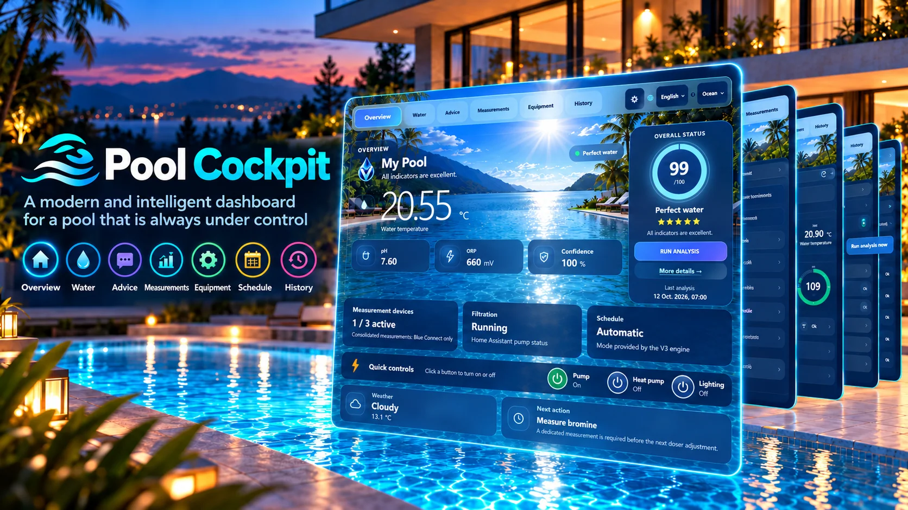

> **Version V4.1.0 (branche de livraison)** — Le complément Réel/Démonstration est décrit dans [les notes V4.1.0](docs/releases/V4.1.0.md). Il nécessite une V4 compatible déjà installée. Le code V4.0.0 ci-dessous reste la base du système ; `main` n'est pas modifiée.

<div align="center">

# 🌊 Pool Cockpit V4.0.0

### Your pool. One elegant cockpit.

**Water monitoring · Advice · Devices · Equipment · Planning · History**

**English** · [**Français**](README.fr.md)

  



<sub>Promotional illustration from RC1. Screenshots below show this earlier interface; certain details have since changed.</sub>

</div>

## ✨ Meet Pool Cockpit

Pool Cockpit brings water measurements, contextual advice, connected sensors, equipment and schedules into one Home Assistant dashboard. **You don't need to have sensors already installed just to open the interface**: unavailable readings are labelled instead of invented.

### Overview


### Advice and measurements

| Advice | Measurement devices |
|:---:|:---:|
|  |  |

### Equipment and planning

| Equipment | Planning |
|:---:|:---:|
|  |  |

V4.0.0 has **six tabs**: Overview, Advice, Measurements, Equipment, Planning and History. The RC1 Water tab was removed; essential information was consolidated into the remaining views. These original RC1 screenshots are kept as illustrations, not as evidence of the final RC8.2 UI fixes.

## 🚀 Features

- **Water readings:** temperature, pH, ORP and other metrics when provided by Home Assistant.
- **Dynamic discovery:** find and associate compatible monitoring devices and equipment; manage their visibility.
- **Equipment:** monitor devices and, once explicitly configured and validated, control filtration, heat pump and lighting.
- **Planning and history:** schedules, trends and charts where data is available.
- **Premium interface:** four themes, nine supported language options and responsive layouts.
- **Honest missing-data handling:** no fake readings are injected into real mode.

Some legacy V3 strings and hardware-specific integrations may need further refinement on individual installations.

## 📦 Easy installation — New installations

> **Validated scope: Home Assistant Core / Docker**, with access to the `/config` directory (or its equivalent host-side path). V4 has been tested on a fresh Docker Home Assistant without V3 or preconfigured pool sensors. **`install_v4.py` intentionally refuses to overwrite an existing Pool Cockpit installation.** It is not a V3-to-V4 migration tool.

### 1. Requirements

- A working Home Assistant instance and access to its configuration directory, plus a way to restart it.
- Python 3 where you run the installer and Git to retrieve the repository.
- A **full Home Assistant backup** before installing.

### 2. Get Pool Cockpit

On the machine that can access the Home Assistant configuration directory:

```bash
git clone --branch main https://github.com/vinzgithub/ha-pool-cockpit.git
cd ha-pool-cockpit
```

### 3. Check first, without changes

Use the **actual Home Assistant configuration path as seen from the machine running the command**. For example, if `/config` is accessible:

```bash
python3 install_v4.py --config /config --dry-run
```

`PRÊT` means the preflight checks passed. If the script refuses, do not force it: an existing Pool Cockpit setup or a pre-existing `lovelace:` block may need a separate migration procedure.

### 4. Install, validate, restart

```bash
python3 install_v4.py --config /config
```

The installer copies the verified JavaScript and assets, installs the matching backend, creates the Lovelace dashboard and updates its configuration. It first backs up `configuration.yaml` under `.pool_cockpit_backups/`.

**Validate the Home Assistant configuration before restarting** using the appropriate check for your setup. Then restart Home Assistant, refresh your browser and open the **Piscine** dashboard. Associate your devices from the dashboard configuration.

**Safety:** equipment commands require deliberate configuration and validation against your actual hardware; never assume an unverified mapping is safe.

### Integrity verification

The traceable RC8.2 frontend distribution is kept at `release/v4-rc8-2/`:

```bash
cd release/v4-rc8-2
sha256sum -c SHA256SUMS
```

The historical filename `pool-dashboard-v4-rc8-2.js` is retained to track the tested bundle; the published installer reports **4.0.0**.

## 🔁 Backups, upgrades and rollback

- **New installs only:** `install_v4.py` does not overwrite an installed V3 or V4.
- `.pool_cockpit_backups/` contains the original `configuration.yaml`. A full rollback also requires removing the installed dashboard and component files, validating configuration and restarting Home Assistant. **Restoring YAML alone is not a complete uninstall.**
- Keep a complete Home Assistant backup before installing or upgrading.
- The historical V3 release is preserved on [`old-v3`](https://github.com/vinzgithub/ha-pool-cockpit/tree/old-v3). This installer does not automatically migrate V3.

## 🛡️ Privacy and safety

Pool Cockpit uses your own Home Assistant entities and services. It does not replace safety interlocks, automations or maintenance procedures. Never publish tokens, passwords, device identifiers, private configuration or sensitive telemetry.

**License:** [PolyForm Noncommercial 1.0.0](LICENSE). Commercial use is governed by the license terms.

---

<div align="center"><sub>Pool Cockpit V4.0.0 · Home Assistant · Your pool. One elegant cockpit.</sub></div>
