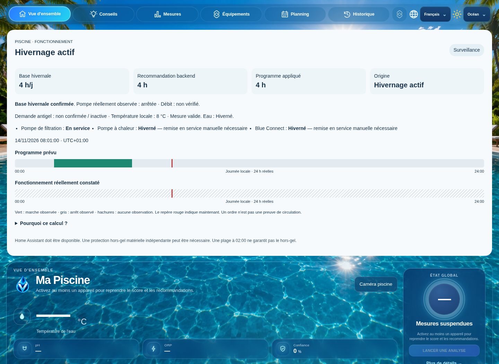
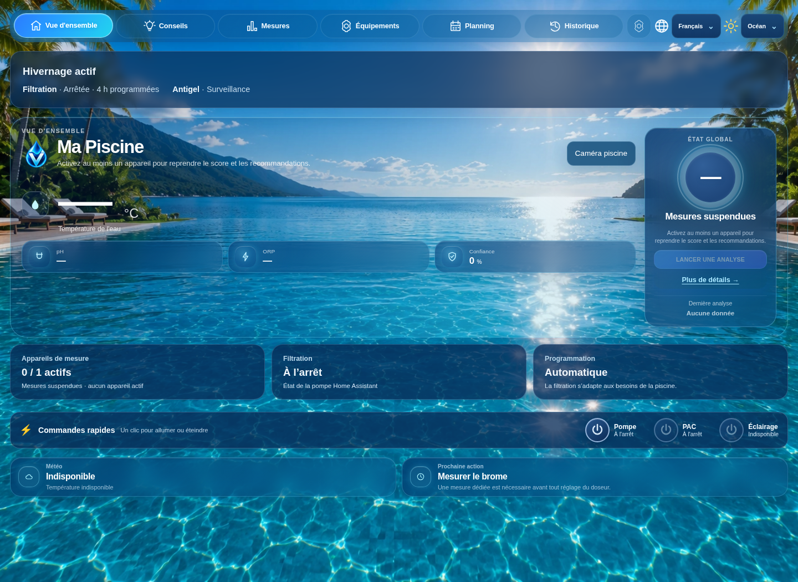
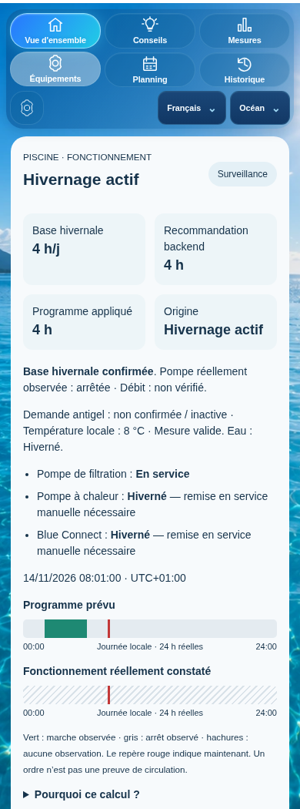
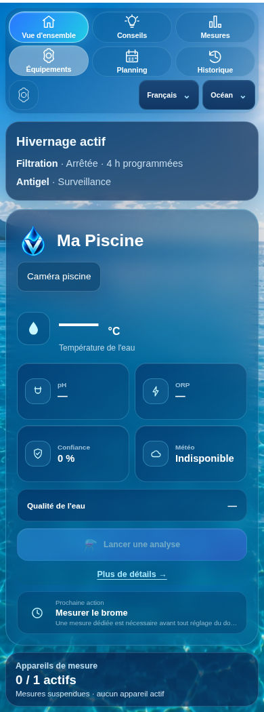
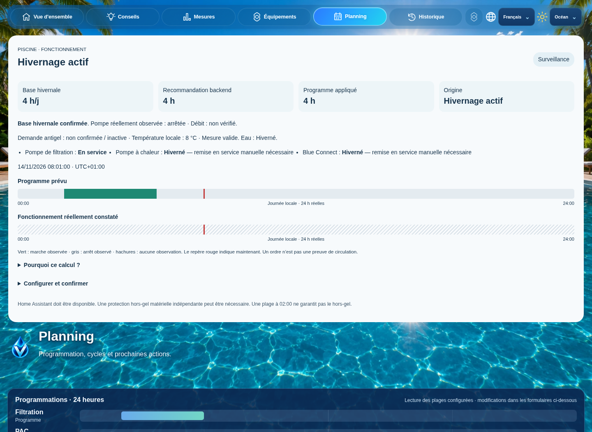
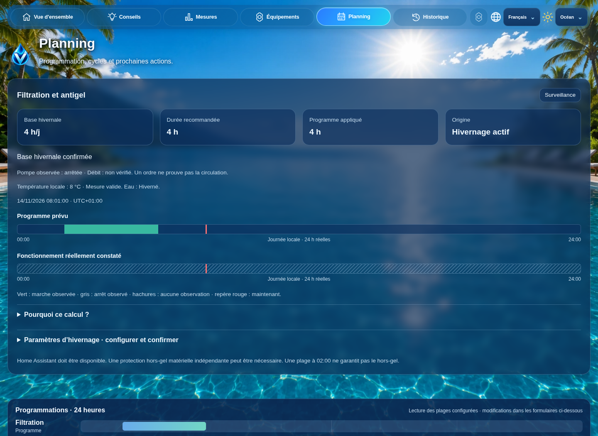
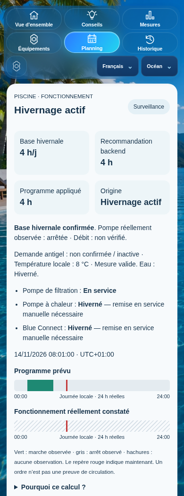
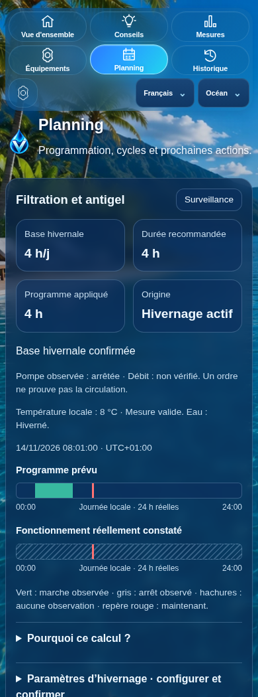

# Révision ergonomique v4.3.0

Cette révision répond à la première recette visuelle de la PR #17. Elle remplace le panneau uniforme par une présentation propre à chaque onglet, sans modification des fichiers Python du backend ni des méthodes de commande ou de confirmation.

## Intégration native

La carte réutilise les composants V4.2.1 `rc8-observation`, `rc8-device-row` et `rc8-message`, ainsi que les variables `--v4-panel-background`, `--v4-card-background`, `--v4-text`, `--v4-muted`, `--v4-border`, `--v4-panel-radius`, `--v4-panel-padding` et `--v4-card-gap`. Le fond clair imposé est supprimé ; les thèmes Océan, Ciel et Nuit restent pilotés par le sélecteur existant. Les titres, fonds translucides, arrondis, espacements et champs reprennent les conventions RC8.

| Vue | Contenu hivernage |
|---|---|
| Vue d'ensemble | Synthèse compacte : mode, état de filtration, durée programmée, antigel et alertes éventuelles |
| Planning | Durées de base/recommandée/appliquée, origine, justification, date locale et frises prévu/observé |
| Équipements | Statuts de la pompe, de la PAC et des sondes ; nécessité de remise en service manuelle |
| Paramètres | Section d'hivernage repliable ; confirmation explicite inchangée |
| Autres onglets | Alertes de sécurité pertinentes, sans répéter les détails de configuration |

Les alertes du backend sont placées hors des sections repliables sur les sept vues. Un backend réel absent/périmé reste signalé. La perte de débit ou le blocage de l'antigel ne sont pas masqués par le changement de présentation.

En Démonstration, aucun `winter_status` réel ou mis en cache n'est présenté : le panneau indique les données simulées et précise que la protection antigel n'est pas simulée. Aucun faux diagnostic de panne backend n'est affiché. La sonde fictive reçoit un timestamp fictif d'acquisition pour être présentable sous les règles de fraîcheur existantes ; aucune règle de mesure réelle n'est assouplie.

## Captures comparatives

Captures Chromium du vrai bundle, sur le même backend HA simulé : hivernage actif, 4 h, PAC et Blue Connect hivernés, capteur local 8 °C. Référence avant : commit `6637434`. Tailles : 1 440 × 1 050 et 390 × 1 050. Le cadrage commence à la navigation pour montrer l'intégration avec les composants voisins. Images WebP sans perte issues des captures PNG ; aucune maquette générée.

| Vue / écran | Avant | Après |
|---|---|---|
| Synthèse ordinateur |  |  |
| Synthèse mobile |  |  |
| Planning ordinateur |  |  |
| Planning mobile |  |  |

Autres vues après révision : [Équipements ordinateur](visuals/after-equipment-1440.webp), [Équipements mobile](visuals/after-equipment-390.webp), [Paramètres dépliés ordinateur](visuals/after-settings-open-1440.webp), [Paramètres dépliés mobile](visuals/after-settings-open-390.webp), [Démonstration ordinateur](visuals/after-demo-1440.webp), [Démonstration mobile](visuals/after-demo-390.webp).

## Non-régression et limites

Les tests de présentation vérifient la répartition par onglet, l'exclusion des états réels en Démonstration, les alertes hors sections repliées, la configuration réservée au maître disponible et l'échappement HTML. Le test navigateur `tests/wintering-visual.browser.cjs` vérifie le responsive, les trois thèmes, la visibilité des alertes sur les sept onglets et le passage Réel/Démonstration. Les captures sont également produites par la CI.

Les tests Python, JavaScript, navigateur/backend et météo existants sont conservés. Les méthodes de filtrage, calcul, sauvegarde, commandes physiques et confirmation sont inchangées ; les modifications dans `host.js` concernent le rendu et un libellé de démonstration uniquement. Aucun déploiement ni fusion. La validation visuelle finale par Vincent reste requise.

## Ajustement complémentaire après recette fonctionnelle (19 novembre 2026)

La recette sur Home Assistant isolé a confirmé les transitions hivernage/antigel et la réactivation indépendante des équipements. Une retouche d'affichage a ensuite été demandée pour la vue Équipements :

- les quatre statuts sont présentés en cartes compactes, sur une ligne lorsque la largeur le permet, avec retour à la ligne sur petits écrans ;
- « En service » reste un **statut de disponibilité**, distinct de l'état réel « en marche / arrêté » ;
- la PAC porte une mention explicite « Commande PAC désactivée dans Pool Cockpit » tant que le backend indique `write_enabled: false` ;
- en cas de backend non confirmé, la mention devient « Commande PAC non confirmée », sans faux sentiment de sécurité ;
- la démonstration ne réutilise pas l'état de commande réel.

Retouche purement visuelle : aucune modification des garde-fous, horaires, algorithmes d'antigel ou commandes PAC. Les fichiers source, feuille de style, tests unitaires et bundle de distribution restent synchronisés.
